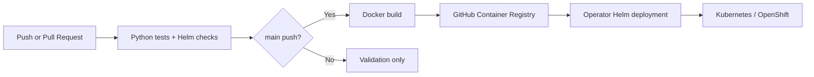

# DevOps CI/CD Reference Pipeline

[](https://github.com/Amor573/devops-cicd-reference-pipeline/actions/workflows/ci.yml)

A deliberately small, **runnable Cloud/DevOps engineering project**: test a Python HTTP service, containerize it, publish an image to GitHub Container Registry, and manage Kubernetes/OpenShift deployments with Helm.

**Status:** Portfolio lab. CI and image-publish status should be verified in the repository's Actions tab; a live cluster deployment has not yet been verified.

## Architecture



| Layer | Implementation |
| --- | --- |
| Service | Python standard library HTTP server; `/`, `/healthz`, `/readyz`, `/metrics` |
| Quality | Five HTTP tests via `unittest` |
| Image | Non-root Python 3.13 slim container |
| CI/CD | GitHub Actions verify + conditional GHCR image publish |
| Deployment | Helm Deployment, Service, optional Ingress/HPA |
| Security | Read-only container filesystem, seccomp, drop capabilities, no service token |
| Operations | Smoke tests, log checks and rollback commands |

## Test locally

```bash
python -m unittest discover -s tests -v
python -m src.app
# another terminal:
bash scripts/smoke-test.sh http://localhost:8080
```

## Build container

```bash
docker build -t platform-demo:local .
docker run --rm -p 8080:8080 platform-demo:local
```

## GitHub Actions and packages

On every PR targeting `main`, Actions runs the HTTP tests and Helm lint/render checks. A successful push to `main` also publishes `ghcr.io/amor573/devops-cicd-reference-pipeline:latest` plus a `sha-<full-commit-sha>` tag.

Publishing requires `GITHUB_TOKEN` package-write permissions, configured per workflow job. GitHub Packages may default to private, so review GHCR package visibility before any anonymous pulls.

## Deploy after the image exists

```bash
kubectl create namespace platform-demo
helm lint charts/platform-demo
helm upgrade --install platform-demo charts/platform-demo -n platform-demo \
  --set image.repository=ghcr.io/amor573/devops-cicd-reference-pipeline \
  --set image.tag=latest
kubectl rollout status deployment/platform-demo-platform-demo -n platform-demo
kubectl port-forward -n platform-demo svc/platform-demo-platform-demo 8080:80
```

Use `oc` instead of `kubectl` for OpenShift if preferred. For stronger reproducibility use a successful `sha-...` image tag, not mutable `latest`.

## Troubleshoot / roll back

```bash
kubectl get pods,deploy,svc -n platform-demo
kubectl get events -n platform-demo --sort-by=.metadata.creationTimestamp
kubectl logs -n platform-demo -l app.kubernetes.io/name=platform-demo --tail=100
helm history platform-demo -n platform-demo
helm rollback platform-demo <REVISION_NUMBER> -n platform-demo
```

The chart does **not** automatically deploy to a cluster; the GitHub workflow does not store kubeconfig or cloud credentials. See `docs/operations.md` and `docs/security.md` for limitations and safeguards.

**Next:** validate a real Kubernetes/OpenShift deployment, record sanitized rollout evidence, then add image scanning, SBOM and GitOps promotion.
